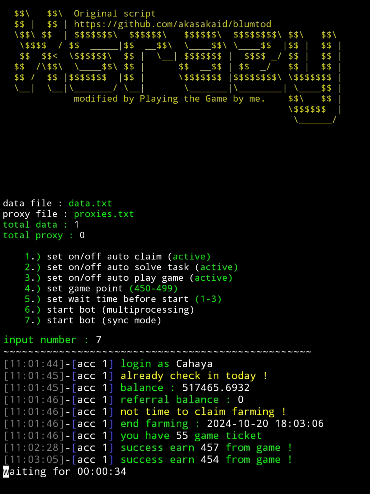

# Blum-BOT-Updated

An updated Blum farming bot for the Blum Telegram mini app, with query data support: automatic claims, daily check-ins, task completion, game play, and referral claims across multiple accounts, with proxy support and a total balance report.



> **Modification notice:** this repository is a modified version of [blumtod](https://github.com/akasakaid/blumtod) by [akasakaid](https://github.com/akasakaid). The original script is credited in the bot's banner and in the Credits section below. The differences from the original are listed under Modifications.

## About

Blum-BOT-Updated automates the repetitive parts of the Blum Telegram mini app (t.me/BlumCryptoBot): claiming farm rewards every 8 hours, daily check-ins, completing tasks, playing the drop game, and claiming referral results. Accounts are read from a data file containing Telegram query data, and each account can run through its own proxy in a separate process.

## Features

- Automatic claim every 8 hours
- Automatic daily check-in (login)
- Automatic claim of referral results
- Automatic task completion
- Automatic game play after claiming, with a configurable points range
- Proxy support, one proxy per account from a proxy list file
- Multi-process support, so accounts run in parallel
- Random user-agent per session
- Total balance report across all accounts
- Optional waiting time before the program starts

## Configuration

Behavior is controlled in `config.json`:

- `auto_claim`, `auto_task`, `auto_game`: turn the automatic claim, task, and game features on or off
- `low`, `high`: waiting-time range before starting
- `clow`, `chigh`: the game points range the bot aims for

## How to Use

1. Register through the Blum bot: https://t.me/BlumCryptoBot/
2. Put your accounts' query data in `data.txt` (one account per line) and your proxies in `proxies.txt`
3. Install the dependencies and run:

```bash
pip install -r requirements.txt
python bot.py
```

Command line options:

- `--data` / `-D`: use a different account data file (default `data.txt`), for example `python bot.py --data query.txt`
- `--proxy` / `-P`: use a different proxy list file (default `proxies.txt`)

The same commands work on Windows, Linux, and Termux. Run reports can be viewed with the report module (`report.py`).

## Architecture

- Python, built on `requests` and `httpx` (with SOCKS proxy support), `aiofiles` and `aiosqlite` for asynchronous file and SQLite storage, and `fake-useragent` for random user-agents
- `bot.py`: the main bot (multi-account, multi-process runner)
- `models.py`: account and session data models
- `report.py`: the total balance report across accounts
- Account state is kept locally in a SQLite database and the `data.txt` / `proxies.txt` files

## Modifications

Compared with the original [akasakaid/blumtod](https://github.com/akasakaid/blumtod) repository:

- **Added:** `report.py` (the total balance report) and `models.py`; a prebuilt `Updated.zip`; a screenshot
- **Changed:** `bot.py` expanded (about 600 to about 740 lines); `config.json`, `requirements.txt`, `README.md`, and `.gitignore` adjusted
- **Removed:** the original's Indonesian README (`README_ID.md`) and its `images/` folder with sponsor banners

## Warning

All risks are borne by the user. Automating a Telegram mini app can violate the platform's terms and get accounts banned; Blum's airdrop campaign has also ended since this bot was written, so the repository is kept mainly as an archive of the 2024 farming-bot era.

## Credits

- Original script: [akasakaid/blumtod](https://github.com/akasakaid/blumtod) by [akasakaid](https://github.com/akasakaid)
- This updated version: [Xsrazy](https://github.com/xsrazy)

## License

MIT License. See [LICENSE](LICENSE) for details.

<a href="https://www.buymeacoffee.com/xsrazy" target="_blank"></a>
